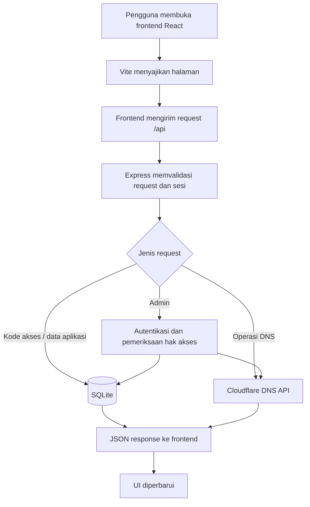

<p align="center">
  <h1 align="center">SubForge</h1>
  <p align="center">Platform pengelolaan subdomain dan DNS otomatis berbasis Cloudflare.</p>
</p>

<p align="center">
  
  
  
  
  
  
</p>

SubForge adalah aplikasi web untuk mengelola subdomain dan record DNS melalui Cloudflare. Project ini menyediakan halaman publik, login pengguna, dashboard pengguna, favorit subdomain, pemeriksaan status, serta dashboard admin untuk mengatur domain, kode akses, record DNS, sinkronisasi, dan aktivitas.

Project ini ditujukan sebagai fondasi yang dapat dikembangkan sendiri. Pengoperasian DNS nyata membutuhkan domain, Zone ID, dan API Token Cloudflare milik operator. Semua kredensial harus disediakan oleh pemilik deployment melalui konfigurasi lokal—jangan memasukkan token pribadi ke source code atau repository publik.

## Daftar Isi

- [Fitur](#fitur)
- [Cara Kerja Sistem](#cara-kerja-sistem)
- [Stack Teknologi](#stack-teknologi)
- [Struktur Project](#struktur-project)
- [Halaman Aplikasi](#halaman-aplikasi)
- [Alur Pengguna](#alur-pengguna)
- [Fitur Admin](#fitur-admin)
- [API](#api)
- [Instalasi](#instalasi)
- [Konfigurasi Environment](#konfigurasi-environment)
- [Menjalankan Aplikasi](#menjalankan-aplikasi)
- [Keamanan dan Deployment](#keamanan-dan-deployment)
- [Troubleshooting](#troubleshooting)
- [Kontribusi](#kontribusi)
- [Credit](#credit)
- [Lisensi](#lisensi)

## Fitur

### Pengunjung dan pengguna

- Melihat statistik publik, status layanan, dan daftar domain yang tersedia.
- Memverifikasi kode akses sebelum membuat subdomain.
- Membuat subdomain melalui form yang divalidasi backend.
- Memilih domain yang telah diaktifkan administrator dan menentukan tipe serta isi record yang didukung oleh form/API.
- Memeriksa ketersediaan atau hasil pemeriksaan DNS melalui endpoint pemeriksaan DNS.
- Login pengguna menggunakan kode/identitas akses yang dikelola aplikasi; sesi disimpan dalam cookie `HttpOnly`.
- Melihat daftar subdomain milik sesi pengguna, mengubah data record yang diizinkan, dan menghapus subdomain melalui dashboard.
- Menandai subdomain sebagai favorit dan membuka halaman favorit.
- Melihat status layanan dan informasi status DNS.

### Administrator

- Login admin dan autentikasi untuk endpoint admin.
- Mengelola kode akses: membuat, mereset, menghapus, memblokir, memperpanjang, serta membersihkan kode yang kedaluwarsa.
- Mengelola daftar domain yang tersedia dan status aktif/nonaktifnya.
- Melihat daftar subdomain dan detail pemakaiannya.
- Menangguhkan atau mengaktifkan kembali subdomain.
- Menghapus record dari database aplikasi atau dari Cloudflare sesuai tindakan yang dipilih.
- Menyinkronkan data antara database lokal dan Cloudflare serta mengimpor data hasil sinkronisasi.
- Melihat statistik, ringkasan, dan log aktivitas.
- Mengatur backup database otomatis dan pembersihan kode kedaluwarsa melalui environment variable.
- Mengirim notifikasi Telegram untuk peristiwa yang didukung jika token dan chat/channel ID telah dikonfigurasi.

> Catatan: daftar fitur di atas merangkum fungsi yang tersedia dalam source saat ini. Hak akses dan tindakan yang tersedia tetap mengikuti validasi pada backend; jangan mengandalkan pembatasan tampilan frontend sebagai kontrol keamanan.

## Cara Kerja Sistem



1. Frontend React menampilkan halaman publik, login, dashboard pengguna, favorit, status, dan dashboard admin.
2. Request aplikasi dikirim ke endpoint `/api`. Dalam development, Vite meneruskan request tersebut ke backend Express pada `localhost:5000`.
3. Backend memeriksa input, kode akses, batas request, sesi, serta hak akses sebelum menjalankan operasi.
4. SQLite menyimpan data aplikasi seperti kode, konfigurasi domain, subdomain, log aktivitas, dan favorit.
5. Untuk operasi DNS, backend berkomunikasi dengan Cloudflare API menggunakan Zone ID dan API Token yang dikonfigurasi oleh operator.
6. Respons backend dikirim ke frontend untuk menampilkan hasil, status, atau pesan kesalahan.
7. Jika diaktifkan, proses terjadwal dapat membersihkan kode kedaluwarsa dan membuat backup database. Notifikasi Telegram bersifat opsional.

## Stack Teknologi

### Frontend

| Bagian | Teknologi | Peran |
| --- | --- | --- |
| UI framework | React 18 | Komponen dan halaman antarmuka |
| Bahasa | JavaScript + JSX | Logika UI, tanpa TypeScript |
| Build/dev server | Vite 5 | Development server dan build produksi |
| Ikon | `lucide-react` | Ikon antarmuka |
| Styling | CSS | `styles.css` dan `theme.css`, termasuk styling tema |
| Request API | `fetch` melalui modul API frontend | Komunikasi dengan backend |
| Routing halaman | Beberapa entry HTML dan entry point React | Halaman publik, login, user, favorit, status, dan admin |

Frontend memiliki beberapa entry HTML yang dikompilasi oleh Vite. Ini bukan Next.js dan tidak menggunakan Tailwind atau framework UI besar.

### Backend

| Bagian | Teknologi | Peran |
| --- | --- | --- |
| Runtime | Node.js | Menjalankan backend JavaScript |
| Web framework | Express 4 | REST API dan middleware |
| Database driver | `better-sqlite3` | Akses SQLite secara sinkron |
| Database | SQLite | Penyimpanan data aplikasi lokal |
| Login/token | `jsonwebtoken` | Token autentikasi |
| Cookie | `cookie-parser` | Membaca cookie sesi |
| CORS | `cors` | Mengatur origin frontend yang diizinkan |
| Rate limiting | `express-rate-limit` | Membatasi request tertentu |
| Environment | `dotenv` | Memuat konfigurasi dari `.env` |
| DNS provider | Cloudflare REST API | Operasi record DNS |
| Notifikasi opsional | Telegram Bot API | Mengirim notifikasi bila dikonfigurasi |
| Enkripsi token | Node.js `crypto`, AES-256-GCM | Mengenkripsi token provider pada penyimpanan ketika `DATA_KEY` diaktifkan |

### Penyimpanan

SQLite digunakan sebagai database lokal. File database dibuat oleh backend saat aplikasi berjalan. Database dapat memuat data operasional yang sensitif; jangan mengunggah file database produksi ke GitHub. Backup juga perlu dilindungi dan disimpan di lokasi yang aksesnya terbatas.

## Struktur Project

```text
subforge/
├── backend/
│   ├── server.js             # Express API, autentikasi, database, Cloudflare integration
│   ├── package.json          # Dependensi dan perintah backend
│   ├── package-lock.json
│   ├── .env.example          # Template environment tanpa kredensial aktif
│   └── .gitignore
├── frontend/
│   ├── index.html            # Halaman landing/public
│   ├── login.html            # Halaman login
│   ├── user.html             # Dashboard pengguna
│   ├── favorites.html        # Halaman favorit
│   ├── status.html           # Halaman status
│   ├── admin.html            # Dashboard administrator
│   ├── vite.config.js        # Konfigurasi Vite dan proxy API development
│   ├── package.json
│   └── src/
│       ├── api.js            # Helper komunikasi API
│       ├── *App.jsx          # Komponen halaman React
│       ├── *-main.jsx        # Entry point React
│       ├── styles.css        # Styling utama
│       └── theme.css         # Styling tema
├── .gitignore
└── README.md
```

## Halaman Aplikasi

| File/halaman | Kegunaan |
| --- | --- |
| `index.html` | Landing page dan informasi publik |
| `login.html` | Login pengguna |
| `user.html` | Dashboard subdomain milik pengguna |
| `favorites.html` | Daftar subdomain favorit |
| `status.html` | Status aplikasi/layanan |
| `admin.html` | Panel administrator |

URL akhir mengikuti konfigurasi hosting. Saat menjalankan Vite secara lokal, file HTML dapat dibuka melalui development server pada port `5173`.

## Alur Pengguna

1. Pengunjung membuka halaman publik dan melihat domain yang tersedia.
2. Pengunjung memasukkan kode akses. Backend memeriksa apakah kode ditemukan, masih berlaku, dan tidak diblokir atau melewati batas yang ditetapkan.
3. Pengguna mengirim permintaan pembuatan subdomain beserta data record yang diperlukan.
4. Backend memvalidasi input, kebijakan nama/record, kode akses, dan domain tujuan.
5. Backend membuat atau memperbarui record melalui Cloudflare API dan menyimpan metadata yang diperlukan ke SQLite.
6. Pengguna dapat login untuk melihat serta mengelola subdomain yang terkait dengan aksesnya, termasuk favorit dan perubahan yang diizinkan.
7. Jika record perlu diubah atau dihapus, backend menjalankan operasi sesuai otorisasi dan hasil dari provider.

## Fitur Admin

Dashboard admin adalah antarmuka untuk mengelola operasi layanan. Endpoint administratif selain login dilindungi middleware autentikasi.

- **Kode akses:** pengelolaan siklus hidup kode, pemakaian, pemblokiran, perpanjangan, dan pembersihan.
- **Domain:** menampilkan domain terkonfigurasi dan mengaktifkan/menonaktifkan domain.
- **Subdomain:** melihat data subdomain, menghapus, menangguhkan, dan mengaktifkan kembali sesuai fungsi yang tersedia.
- **Sinkronisasi:** membandingkan atau menyinkronkan data aplikasi dengan record DNS Cloudflare; tindakan hapus database dan hapus Cloudflare merupakan tindakan berbeda.
- **Statistik dan log:** ringkasan penggunaan dan catatan aktivitas untuk membantu audit serta troubleshooting.
- **Backup dan cleanup:** proses otomatis dapat diatur melalui environment variable.

## API

Endpoint berikut terdaftar di backend. Untuk detail field request/response, validasi, dan format error, rujuk implementasi `backend/server.js`.

### Publik

| Method | Endpoint | Fungsi |
| --- | --- | --- |
| `GET` | `/api/public-stats` | Statistik publik |
| `GET` | `/api/public/status` | Status publik |
| `GET` | `/api/blacklist` | Informasi blacklist yang dipublikasikan aplikasi |
| `GET` | `/api/domains` | Daftar domain aktif |
| `POST` | `/api/verify-code` | Memvalidasi kode akses |
| `POST` | `/api/subdomain` | Membuat subdomain/record |
| `POST` | `/api/dns/check` | Pemeriksaan DNS |

### Admin

| Method | Endpoint | Fungsi |
| --- | --- | --- |
| `POST` | `/api/admin/login` | Login admin |
| `GET` | `/api/admin/me` | Memeriksa sesi admin |
| `POST` | `/api/admin/logout` | Logout admin |
| `GET` / `POST` | `/api/admin/codes` | Daftar dan membuat kode akses |
| `POST` | `/api/admin/codes/:id/reset` | Reset data pemakaian kode |
| `DELETE` | `/api/admin/codes/:id` | Menghapus kode |
| `POST` | `/api/admin/codes/cleanup` | Menjalankan cleanup kode |
| `GET` | `/api/admin/domains` | Daftar domain untuk admin |
| `PATCH` | `/api/admin/domains/:id` | Mengubah pengaturan domain |
| `GET` | `/api/admin/status` | Status/admin checks |
| `GET` | `/api/admin/subdomains` | Daftar subdomain |
| `DELETE` | `/api/admin/subdomains/:id` | Menghapus subdomain |
| `GET` | `/api/admin/stats` | Statistik admin |
| `GET` | `/api/admin/sync` | Informasi sinkronisasi |
| `POST` | `/api/admin/sync/db-remove` | Menghapus data lokal yang dipilih |
| `POST` | `/api/admin/sync/cf-remove` | Menghapus record Cloudflare yang dipilih |
| `POST` | `/api/admin/sync/import` | Mengimpor hasil sinkronisasi |
| `POST` | `/api/admin/subdomains/:id/suspend` | Menangguhkan subdomain |
| `POST` | `/api/admin/subdomains/:id/unsuspend` | Mengaktifkan kembali subdomain |
| `POST` | `/api/admin/codes/:id/block` | Memblokir/membuka blokir kode |
| `POST` | `/api/admin/codes/:id/extend` | Memperpanjang kode |
| `GET` | `/api/admin/summary` | Ringkasan admin |
| `GET` | `/api/admin/logs` | Melihat log aktivitas |

### Pengguna

| Method | Endpoint | Fungsi |
| --- | --- | --- |
| `POST` | `/api/user/login` | Login pengguna |
| `POST` | `/api/user/logout` | Logout pengguna |
| `GET` | `/api/user/me` | Informasi sesi pengguna |
| `GET` | `/api/user/subdomains` | Daftar subdomain pengguna |
| `GET` | `/api/user/favorites` | Daftar favorit |
| `POST` | `/api/user/subdomains/:id/favorite` | Mengubah status favorit |
| `PATCH` | `/api/user/subdomains/:id` | Memperbarui record yang diizinkan |
| `DELETE` | `/api/user/subdomains/:id` | Menghapus subdomain pengguna |

## Instalasi

### Prasyarat

- Node.js yang kompatibel dengan `better-sqlite3` versi yang digunakan (disarankan Node.js 20 LTS).
- npm.
- Domain yang dikelola di Cloudflare.
- Cloudflare API Token dengan izin minimum yang diperlukan untuk membaca dan mengelola DNS pada zone yang dipilih.
- Zone ID untuk setiap domain yang ingin dikelola.

### 1. Clone repository

```bash
git clone <URL-REPOSITORY-ANDA>
cd subforge
```

Jika struktur folder repository Anda berbeda, masuk ke folder project yang berisi `backend/` dan `frontend/`.

### 2. Pasang dependensi backend

```bash
cd backend
npm install
cp .env.example .env
```

Edit `backend/.env` menggunakan editor pilihan Anda. Jangan pernah commit file `.env`.

### 3. Pasang dependensi frontend

Buka terminal kedua dari direktori root project:

```bash
cd frontend
npm install
```

### 4. Siapkan konfigurasi

Isi variabel yang diperlukan di `backend/.env`. Pastikan `JWT_SECRET`, username/password admin, serta `DATA_KEY` dibuat sendiri dan tidak dibagikan.

### 5. Jalankan dalam mode development

Terminal 1 — backend:

```bash
cd backend
npm run dev
```

Terminal 2 — frontend:

```bash
cd frontend
npm run dev
```

Vite menggunakan port `5173` dan meneruskan request `/api` ke `http://localhost:5000`. Jika port backend diubah, sesuaikan proxy pada `frontend/vite.config.js`.

## Konfigurasi Environment

Template yang tersedia adalah `backend/.env.example`.

| Variabel | Fungsi | Catatan |
| --- | --- | --- |
| `PORT` | Port backend | Default `5000` |
| `JWT_SECRET` | Secret untuk menandatangani JWT | Gunakan nilai acak panjang dan rahasia |
| `ADMIN_USERNAME` | Username admin | Tetapkan sendiri sebelum deployment |
| `ADMIN_PASSWORD` | Password admin | Gunakan password unik yang kuat |
| `DOMAINS_JSON` | Konfigurasi domain awal dalam format JSON | Harus JSON valid; gunakan konfigurasi domain milik sendiri |
| `TELEGRAM_BOT_TOKEN` | Token bot Telegram | Opsional; rahasia, jangan commit |
| `TELEGRAM_CHANNEL_ID` | ID chat/channel tujuan Telegram | Opsional |
| `TELEGRAM_ADMIN_ID` | ID admin Telegram | Opsional, untuk fungsi yang membutuhkannya |
| `BLACKLIST_NAMES` | Nama/label DNS yang dilarang | Daftar dipisahkan koma |
| `AUTO_CLEANUP_INTERVAL_MINUTES` | Interval pembersihan kode kedaluwarsa | `0` menonaktifkan interval otomatis |
| `CORS_ORIGINS` | Origin frontend yang diizinkan | Pisahkan beberapa origin dengan koma |
| `TRUST_PROXY` | Konfigurasi kepercayaan proxy Express | Atur sesuai topologi reverse proxy, jangan asal mengaktifkan |
| `MAX_SUBDOMAINS_PER_CODE` | Batas subdomain per kode | Sesuaikan dengan kebijakan layanan |
| `DATA_KEY` | Kunci enkripsi token provider | 64 karakter hexadecimal untuk 32 byte; kosong berarti enkripsi token tidak aktif |
| `ALLOW_PRIVATE_IP` | Mengizinkan atau menolak target IP privat, sesuai implementasi | Evaluasi risiko sebelum diaktifkan |
| `BACKUP_DIR` | Direktori backup | Batasi akses folder dan kapasitas disk |
| `BACKUP_INTERVAL_HOURS` | Interval backup dalam jam | Atur sesuai kebutuhan |
| `BACKUP_KEEP` | Jumlah backup yang dipertahankan | Tetapkan jumlah yang masuk akal |
| `NODE_ENV` | Mode runtime Node.js | Gunakan `production` untuk deployment produksi |

### Membuat secret yang aman

Buat secret JWT dengan Node.js:

```bash
node -e "console.log(require('crypto').randomBytes(48).toString('hex'))"
```

Buat `DATA_KEY` 32 byte dalam format hexadecimal:

```bash
node -e "console.log(require('crypto').randomBytes(32).toString('hex'))"
```

Simpan nilainya hanya di file `.env` pada server. Jika `DATA_KEY` diganti setelah token terenkripsi tersimpan di database, aplikasi mungkin tidak dapat mendekripsi token tersebut. Simpan kunci dengan aman dan lakukan backup sebelum rotasi.

## Menjalankan Aplikasi

### Build frontend

```bash
cd frontend
npm run build
```

Build Vite biasanya menghasilkan direktori `frontend/dist`. Backend saat ini berfokus pada API; konfigurasi serving frontend hasil build melalui Express atau web server terpisah perlu disesuaikan dengan kebutuhan deployment Anda. Jangan menganggap `npm start` di backend otomatis menyajikan frontend tanpa konfigurasi tambahan.

### Deployment produksi yang disarankan

- Jalankan backend melalui process manager (misalnya systemd atau PM2) atau container.
- Sajikan frontend build melalui web server statis/reverse proxy.
- Proxy `/api` ke backend dan batasi akses langsung ke port backend jika memungkinkan.
- Aktifkan HTTPS.
- Gunakan origin CORS yang spesifik.
- Pastikan volume database dan backup persisten.
- Pantau log, kapasitas disk, serta kegagalan koneksi ke Cloudflare/Telegram.

## Keamanan dan Deployment

- **Rahasia:** jangan commit `.env`, token Cloudflare/Telegram, JWT secret, password admin, database, atau backup.
- **Cloudflare token:** batasi token ke zone dan izin DNS yang benar-benar dibutuhkan. Jangan memakai Global API Key jika API Token dengan izin minimum sudah cukup.
- **Enkripsi token:** `DATA_KEY` harus dikonfigurasi untuk mengenkripsi token provider yang disimpan. Melindungi database tanpa melindungi key tetap tidak cukup; simpan key terpisah dari backup database.
- **HTTPS:** gunakan HTTPS pada deployment publik. Cookie sesi ditandai `Secure` pada mode production.
- **CORS dan proxy:** atur `CORS_ORIGINS` serta `TRUST_PROXY` sesuai infrastruktur. Konfigurasi proxy yang salah dapat membuat pembacaan IP dan rate limiting tidak akurat.
- **Hak akses:** periksa bahwa endpoint admin dan endpoint pengguna hanya mengizinkan operasi atas data yang berhak diakses oleh sesi tersebut.
- **DNS berisiko:** salah memilih zone, record, atau operasi delete dapat mengganggu domain. Uji terlebih dahulu pada zone non-produksi.
- **Database:** SQLite sesuai untuk deployment sederhana dengan satu instance backend. Jangan menyalin file database saat proses menulis tanpa prosedur backup yang konsisten.
- **Backup:** database dan backup mungkin berisi data sensitif. Batasi permission, lokasi, retensi, dan akses unduh.
- **IP pengguna:** jangan menganggap IP sebagai identitas yang stabil; VPN, jaringan bersama, proxy, dan perubahan jaringan dapat memengaruhi hasil.
- **Open source:** sebelum membuat repository publik, periksa riwayat Git untuk secret lama. Menghapus secret dari file terbaru tidak menghapusnya dari commit sebelumnya. Cabut/rotasi token yang pernah terekspos.

## Troubleshooting

| Masalah | Yang perlu diperiksa |
| --- | --- |
| Frontend tidak dapat mengakses API | Pastikan backend berjalan di port `5000`, lalu cek proxy pada `frontend/vite.config.js` |
| CORS error | Pastikan `CORS_ORIGINS` cocok dengan origin frontend yang sedang digunakan |
| Login admin gagal | Periksa `ADMIN_USERNAME`, `ADMIN_PASSWORD`, `JWT_SECRET`, cookie, dan log backend |
| Operasi Cloudflare gagal | Periksa API Token, izin token, Zone ID, domain, serta respons/error Cloudflare |
| Token provider tidak bisa dibaca | Pastikan `DATA_KEY` sama dengan key saat token dienkripsi dan berformat 64 karakter hex |
| SQLite gagal dipasang | Gunakan versi Node.js yang kompatibel dengan `better-sqlite3`, lalu jalankan ulang `npm install` |
| Port sudah dipakai | Hentikan proses yang menggunakan port atau ubah `PORT` dan konfigurasi proxy yang sesuai |
| Telegram tidak mengirim pesan | Periksa `TELEGRAM_BOT_TOKEN`, `TELEGRAM_CHANNEL_ID`, izin bot, dan log backend |

## Kontribusi

Kontribusi sangat dipersilakan.

1. Fork repository.
2. Buat branch fitur atau perbaikan.
3. Lakukan perubahan sekecil dan sejelas mungkin.
4. Uji perubahan sebelum mengirim.
5. Buka Pull Request dengan penjelasan masalah, perubahan, dan langkah pengujian.
6. Untuk bug, sertakan langkah reproduksi dan log yang sudah disensor.

**Jangan pernah menyertakan** `.env`, token, password, database produksi, data pengguna, atau backup sensitif dalam Issue/Pull Request.

## Credit

```text
Creator : momonpxl
Sosmed  : Instagram & TikTok -> @momonpxl
Join Channel WhatsApp admin : https://whatsapp.com/channel/0029VbDYUWf8qIzlSl4slR0t

Jangan hapus credit dari Developer, hargailah Dev.
Kalau kalian menemukan bug, silakan pull request ya.
```

Credit developer asli wajib tetap dipertahankan. Jangan menghapus atribusi yang sudah ada pada source code atau dependensi milik pihak lain.

## Lisensi

Pastikan repository menyertakan file `LICENSE` sebelum dipublikasikan sebagai project open source. Jika belum ada lisensi, jangan menyatakan project ini berlisensi MIT atau lisensi lain. Pilih lisensi yang sesuai dengan hak dan izin dari seluruh kontributor serta developer asli.
